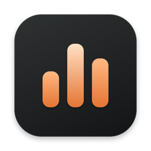
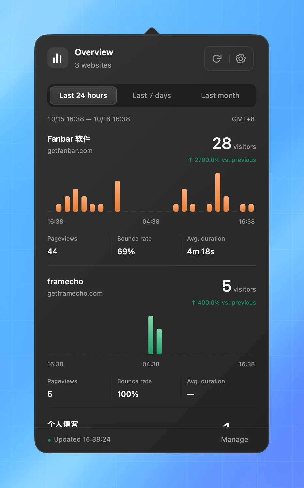
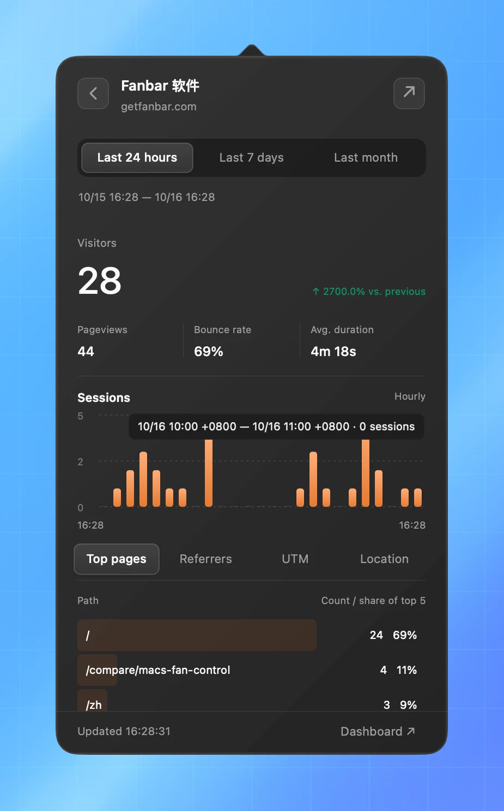
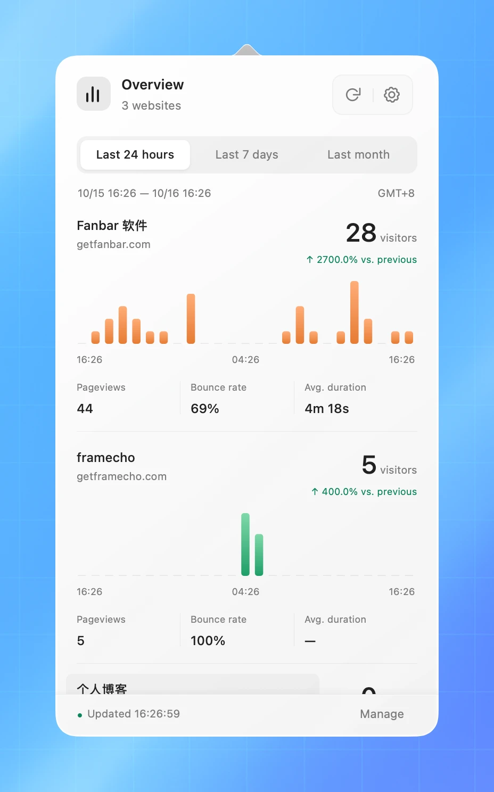
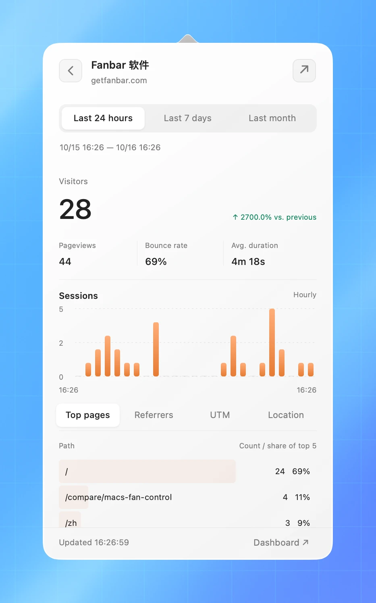

<p align="center">
  
</p>

<h1 align="center">UmamiBar</h1>

<p align="center">
  <a href="https://github.com/helson-lin/umamibar/actions/workflows/ci.yml"></a>
  <a href="https://github.com/helson-lin/umamibar/releases"></a>
</p>


<p align="center">原生 macOS 菜单栏 Umami 客户端</p>

<p align="center">
  <a href="#requirements" title="Intel: macOS 10.15+; Apple Silicon: macOS 11+"></a>
  
  
  
  
</p>

<p align="center">
  <a href="README.md">English</a> · <a href="README.zh-CN.md">简体中文</a>
</p>

轻量的 macOS 菜单栏 Umami 客户端。在同一个浮窗查看多个网站，了解流量变化，并下钻查看网站详情。

使用 **AppKit 自绘**、`URLSession` 和 macOS Keychain。应用不嵌入 WebKit，不需要启动本地网页服务；HTML 原型仅作为独立设计参考。

## 目录

- [功能](#功能)
- [截图](#截图)
- [环境要求](#requirements)
- [Homebrew 安装](#homebrew-安装)
- [构建与运行](#构建与运行)
- [连接 Umami](#连接-umami)
- [查看网站](#查看网站)
- [数据口径](#数据口径)
- [开发与检查](#开发与检查)
- [项目结构](#项目结构)
- [常见问题与当前限制](#常见问题与当前限制)

## 功能

- **多个网站**：统一展示访客总数、迷你会话图表及访问质量指标。
- **四种时间范围**：今天（与昨日同时段对比）、最近 24 小时、最近 7 天、最近一个月。
- **同期对比**：对比紧邻此前的等长时段，上期为零时单独显示“新增”。
- **网站详情**：点击网站名称或图表，查看完整会话趋势、热门页面和流量来源。
- **原生交互**：图表悬停显示数值、方向键查看时间桶、返回时恢复概览滚动位置。
- **自动外观**：明暗主题跟随系统，使用玻璃面板和暖橙图表。
- **原生菜单栏尺寸**：仅图标使用系统标准方形宽度，显示数字时随内容自适应；等宽数字、大数值缩写，悬停查看完整数值。
- **刷新反馈**：加载时显示转圈，更新时间精确到秒；浮窗打开期间定期刷新。
- **日常偏好**：登录时启动、网站排序与置顶、菜单栏数字配置和离线数据恢复。
- **安全存储**：API Key 保存到钥匙串，网站选择和偏好保存在本地。

> 应用支持简体中文、英文与跟随系统，可在“通用 → 语言”中切换。

## 截图

| 模式 | 概览 | 网站详情 |
| --- | --- | --- |
| 深色 |  |  |
| 浅色 |  |  |

截图使用示例数据。

<a id="requirements"></a>

## 环境要求

| 项目 | 要求 |
| --- | --- |
| Intel Mac | 部署目标为 macOS 10.15 Catalina 及以上 |
| Apple Silicon Mac | 部署目标为 macOS 11 及以上 |
| 构建工具 | 包含 macOS SDK 的 Xcode，Swift 5.9 及以上 |
| Umami | 支持 Bearer API Key 认证的部署 |

应用使用 Sparkle 2 自动检查更新，也可在“设置 → 通用 → 检查更新”手动检查。正式标签 Release 经过签名和公证，支持应用内升级；ad-hoc 签名的 CI 构建不支持应用内更新。Sparkle 是项目唯一的第三方 Swift 包依赖。


## Homebrew 安装

首次 Release 发布且 Cask 更新 PR 合并后：

```sh
brew tap helson-lin/umamibar https://github.com/helson-lin/umamibar
brew install --cask helson-lin/umamibar/umamibar
```

升级：`brew update`，然后 `brew upgrade --cask helson-lin/umamibar/umamibar`。Homebrew 自身对旧版 macOS 的支持与应用最低系统版本不同；旧系统可直接使用 Release ZIP。

从 [Releases](https://github.com/helson-lin/umamibar/releases/latest) 下载通用版 **DMG**，打开后将 **UmamiBar.app** 拖到“应用程序”，推出磁盘映像后启动。正式签名版本支持 Sparkle 自动检查更新，也可在“设置 → 通用 → 检查更新”手动检查。Homebrew 用户使用上述命令升级。

CI 在每次分支推送、PR 和手动运行时，在 Intel 和 Apple Silicon 上测试并打包通用应用。无需打标签：打开 [Actions → CI](https://github.com/helson-lin/umamibar/actions/workflows/ci.yml)，选择成功的运行，从摘要下载 `UmamiBar-macos-15` 或 `UmamiBar-macos-15-intel` 产物（两者均包含通用应用，保留 14 天，下载需登录 GitHub）。解压产物后，再解压其中的 `UmamiBar-<版本>-universal.zip`，将 `UmamiBar.app` 移至“应用程序”。手动打包可选择 **Run workflow** 和目标分支。

推送与 `VERSION` 一致的 `vX.Y.Z` 标签，将自动发布 DMG、ZIP、SHA-256 校验文件、已签名的 Sparkle appcast 和 Homebrew Cask，再创建更新 PR。设置与发布步骤见 [RELEASING.md](docs/RELEASING.md)。

标签发布要求 Developer ID 签名、Apple 公证和 `SPARKLE_EDDSA_PRIVATE_KEY` Actions secret，详见[发布文档](docs/RELEASING.md#developer-id-signing-and-notarization)。普通 CI 产物仍为 ad-hoc 签名、未公证；已有 Release 不受此改动影响。

## 构建与运行

在项目根目录执行：

```sh
./scripts/build-app.sh
open dist/UmamiBar.app
```

应用生成在 `dist/UmamiBar.app`，可自行复制到 Applications 文件夹。应用常驻菜单栏，不显示 Dock 图标。

仅构建本机架构，用于本地开发：

```sh
./scripts/build-app.sh native
```

`native` 模式采用工具链的默认部署目标。验证旧系统最低版本时，请使用默认的 **universal** 构建。

本地和普通 CI 构建为 ad-hoc 签名、未公证，不支持应用内更新；GitHub Actions 标签发布使用 Developer ID 签名、公证和 Sparkle 更新。

重新构建后，应先退出正在运行的旧版（设置窗口 → 通用），再打开新应用。替换磁盘文件不会替换已经运行的进程。

## 连接 Umami

1. 首次启动会自动打开设置窗口（之后可点击浮窗中的齿轮打开）。
2. 在“连接”中填写服务地址或 API 地址及 API Key，点击“验证并选择网站”。
3. 在“网站”中选择需要关注的网站。
4. 点击“保存并查看”，浮窗即显示网站概览。

设置使用独立窗口而非浮窗，切换到浏览器复制 API Key 时窗口不会关闭。

### 服务地址

| 部署方式 | 示例 | 处理方式 |
| --- | --- | --- |
| Umami Cloud | `https://api.umami.is/v1` | 使用 Cloud API 基础地址 |
| 自托管根路径 | `https://analytics.example.com` | 自动补上 `/api` |
| 自托管子路径 | `https://example.com/analytics/api` | 保留填写的路径 |
| 本地开发 | `http://localhost:3000` | 自动补上 `/api`，允许本地 HTTP |

区域 Cloud 地址或自定义代理应填写完整 API 基础地址。非空路径不会自动补齐，因此子路径部署必须包含完整 API 路径。

远程地址要求 HTTPS；仅 `localhost`、`127.0.0.1` 和 `::1` 允许 HTTP。不接受包含用户名密码、查询字符串或片段的 URL。应用拒绝重定向，避免将凭据发送到其他端点。

应用支持 **API Key**，不支持账号密码登录。旧版自托管服务的兼容性取决于其认证方式和可用接口。参考官方 [认证说明](https://docs.umami.is/docs/api/authentication) 与 [Cloud API Key 说明](https://docs.umami.is/docs/cloud/api-key)。

### 修改连接和网站选择

- 点击浮窗中的齿轮打开“通用”页；切换到“连接”可修改凭据。
- API 地址完全相同时，可留空 API Key 字段以复用已保存密钥。
- 概览底部“管理网站”打开“网站”页，列出当前连接下的网站。
- “网站”页按置顶、其他网站与未关注分组。首次连接保存后，关注、置顶、排序与选色即时保存。点击名称后的色点选色，图钉置顶，拖动把手或使用上下移按钮调整组内顺序；取消置顶恢复原普通顺序。
- 取消选择不会从 Umami 删除网站。
- 当前仅支持一个 Umami 实例。

### 语言

UmamiBar 支持简体中文和英文，可在“设置 → 通用 → 语言”中选择“跟随系统”“简体中文”或“English”，立即生效。“跟随系统”使用 macOS 的语言设置，中文以外的语言回退为英文。界面文案位于 `Resources/<语言>.lproj/Localizable.strings`，键为代码中 `L("…")` 的中文原文；缺少翻译时 `tests-release/test_localization.py` 会失败。

### 日常偏好

“通用”页提供登录时启动、语言、菜单栏显示和本地数据设置。登录开关读取系统真实状态，被系统停用时给出恢复入口；macOS 13+ 使用 Apple 的 [SMAppService](https://developer.apple.com/documentation/servicemanagement/smappservice)，macOS 10.15–12 使用本应用的用户 LaunchAgent。登录启动只在菜单栏运行，不自动弹出窗口。渲染检查不会修改系统登录项。

默认保留最近成功数据，存于 `~/Library/Application Support/UmamiBar/successful-data.json`，按服务、网站、时间范围与时区隔离。保存完整统计与趋势结果及原查询时间，不含 API Key。重启先恢复匹配结果并后台刷新；失败不会覆盖成功记录，无记录显示缺失。不同查询终点的数据不会被当作同一范围合计。

点击“已保存数据”可查看范围与清除；关闭保存需确认并清除持久化统计数据，保留连接、密钥、网站顺序及偏好。已显示的在线结果可以继续留在内存。取消关注数字来源网站时，会回退合计并提示；切换凭据会清理旧记录，避免混用权限范围。

## 查看网站

### 概览

每个网站展示访客数、同期变化、迷你会话图表、浏览量、跳出率和平均时长。悬停图表查看时间桶数值，点击名称或图表进入详情。

菜单栏可选择合计访客、指定网站或仅图标，仅图标使用系统标准方形宽度，带数字时由 AppKit 根据内容自动计算宽度。合计为当前时间范围内所有已选网站的访客数之和，**不进行跨站去重**，也不是实时在线人数。大数值使用缩写，提示文字保留完整数值。

### 网站详情

详情沿用当前时间范围，包含：

- 访客总数与同期变化。
- 浏览量、跳出率和平均时长。
- 更完整的会话趋势图。
- 可切换的热门页面与流量来源，各显示最多五项。
- 返回概览和打开该站 Umami 仪表盘的入口。

返回按钮恢复概览滚动位置。Escape 在由面板响应链处理时也会返回。加载、失败、空数据分别展示；详情请求失败时提供重新加载按钮。

### 时间范围与刷新

| 选项 | 时间窗口 | 图表粒度 |
| --- | --- | --- |
| 最近 24 小时 | 向前滚动 24 小时 | 每小时 |
| 最近 7 天 | 向前滚动 168 小时 | 每天 |
| 最近一个月 | 查询终点向前一个自然月 | 每天 |

“最近一个月”不是本月，也不固定为 30 天。分桶和标签使用系统时区，保留首尾不完整时间桶。

浮窗打开时检查缓存是否过期；打开期间通过 60 秒定时器刷新，关闭后暂停常规轮询。手动刷新显示转圈和精确到秒的完成时间。认证或限流错误会暂停自动重试，可通过设置或手动刷新恢复。当前网站请求按顺序执行，选择网站较多时刷新可能更慢。

## 数据口径

| 展示项 | 来源或计算方式 |
| --- | --- |
| 访客数 | stats 接口的 `visitors`，不通过累加图表时间桶计算 |
| 会话趋势 | pageviews 接口的 `sessions`，不是独立访客趋势 |
| 浏览量 | stats 接口的 `pageviews` |
| 跳出率 | `bounces / visits × 100` |
| 平均时长 | `totaltime / (visits - bounces)`，单位秒 |
| 访客变化 | 单独查询紧邻此前的等长时段后比较 |
| 排行占比 | 当前行计数除以返回的前五项计数之和 |

字段缺失或分母无效时显示 `—`。上期为零时显示“新增”或“持平”，不产生无效百分比；同期请求失败则显示不可用的比较状态。

时间序列成功返回后补齐缺失时间桶，空桶为零。部分 Umami SQL 时区分桶会把本地时间标签序列化为带 `Z` 的字符串，应用按该语义处理；若接口存在非零数据却全部落在查询范围外，会显示错误，避免误报“暂无会话”。其他部署的时间戳约定仍需单独验证。

热门页面和来源遵循接口各维度的计数语义，界面显示“次数”。前五项占比 **不是全站占比**。来源接口没有返回行时显示空态，不虚构直接访问数据。

接口参考：[统计总数](https://docs.umami.is/docs/api-reference/get-website-stats)、[时间序列](https://docs.umami.is/docs/api-reference/get-website-pageviews)、[维度排行](https://docs.umami.is/docs/api-reference/get-website-metrics)。

## 开发与检查

运行测试：

```sh
swift test --disable-sandbox \
  --scratch-path /tmp/umamibar-build \
  -Xswiftc -module-cache-path -Xswiftc /tmp/umamibar-module-cache
```

测试覆盖地址校验、新旧统计响应、缺失字段、同期变化、月末边界、稀疏时间序列及分桶时区。临时构建路径避免依赖用户级缓存目录的写权限；`--disable-sandbox` 仅关闭本次 SwiftPM 构建沙盒，不改变应用权限。

编译独立的原生渲染检查工具：

```sh
xcrun swiftc -parse-as-library \
  -module-cache-path /tmp/umamibar-module-cache \
  Sources/UmamiBar/Models.swift \
  Sources/UmamiBar/ChartView.swift \
  Sources/UmamiBar/Components.swift \
  Sources/UmamiBar/NativePanel.swift \
  Sources/UmamiBar/API.swift \
  Sources/UmamiBar/SettingsWindow.swift \
  Sources/UmamiBar/SettingsViews.swift \
  Sources/UmamiBar/Preferences.swift \
  Sources/UmamiBar/SnapshotStore.swift \
  Sources/UmamiBar/LoginLaunch.swift \
  scripts/visual-check.swift \
  -o /tmp/umamibar-native-check

/tmp/umamibar-native-check dark detail
/tmp/umamibar-native-check light empty
/tmp/umamibar-native-check dark settings-general
/tmp/umamibar-native-check dark detail --navigation-tests
```

检查工具需要 macOS 图形会话，使用示例数据，输出 `/tmp/native-<appearance>-<screen>.png`。页面支持 `overview`、`detail`、`empty`、`settings-connection`、`settings-websites` 和 `settings-general`。设置 `UMAMIBAR_MOCK=http://127.0.0.1:PORT`（本地服务需对密钥 `test-key` 响应 `GET /api/websites`）会先走真实的验证 → 网站列表流程；再加 `--save-test` 可检查保存。`--navigation-tests` 验证原生事件派发，不是完整的网络端到端测试。

给应用可执行文件显式传入 `--diagnose-series` 或 `--diagnose-details`，可使用已保存连接进行只读诊断。这些模式会访问钥匙串并请求你的 Umami 服务，只打印计数和状态，不打印密钥、服务地址、网站 ID 或页面路径；时间序列诊断另输出接口时间标签。正常启动不会运行诊断。

## 项目结构

```text
Sources/UmamiBar/
  App.swift          应用生命周期、菜单栏、状态与请求协调
  Components.swift   共享自绘设计系统：颜色、表面、按钮、输入框
  NativePanel.swift  浮窗页面：未连接、概览和详情
  SettingsWindow.swift 设置窗口：连接、网站、通用三个标签页
  ChartView.swift    图表绘制、悬停与键盘交互
  API.swift          HTTP 请求、认证和网站列表分页
  Models.swift       接口模型、时间范围、指标与 URL 规范化
  TimeBuckets.swift  稀疏序列补齐与时间戳处理
  Keychain.swift     凭据存储
  Diagnostics.swift 可选的只读接口诊断
Tests/UmamiBarTests/  核心回归测试
scripts/             应用打包、图标生成和渲染检查
assets/              图标原稿、iconset 与 ICNS
index.html           使用示例数据的交互设计稿
PRD.md               需求与已确认变更
```

单独查看设计稿：

```sh
python3 -m http.server 8765 --bind 127.0.0.1
```

打开 [本地设计稿](http://127.0.0.1:8765/)。其中连接表单不保存或发送 API Key。原生应用不依赖此服务。

## 常见问题与当前限制

- **重建后没有看到新界面**：先退出旧进程，再重新打开生成的 `.app`。
- **连接失败**：检查完整 API 地址、密钥权限和接口兼容性；发生重定向时填写最终目标地址。
- **总数存在，但图表失败**：总数和趋势使用不同接口，请检查错误提示和时间戳兼容性；部分失败时保留仍可用的数据。
- **没有流量来源**：所选时段的来源接口可能合法返回空列表。
- **没有看到团队网站**：网站发现使用 websites 接口，团队可见性取决于服务端返回的列表和权限。
- **旧系统兼容性**：已验证 Intel 最低部署元数据为 10.15，但启动、钥匙串、外观和渲染仍待 Catalina 真机验证。
- **发布能力**：已实现 Developer ID 签名、公证和 Sparkle 应用内更新；登录启动已接入，实际系统登录与 Catalina 行为仍需安装后／真机验收。

需求记录见 [PRD.md](PRD.md)。`docs/previews/` 中的图片使用示例数据，可能滞后于小幅视觉调整。

## GitHub 标签

建议在 GitHub 仓库的 About → Topics 中设置：

[`umami`](https://github.com/topics/umami) · [`macos`](https://github.com/topics/macos) · [`menu-bar`](https://github.com/topics/menu-bar) · [`swift`](https://github.com/topics/swift) · [`appkit`](https://github.com/topics/appkit) · [`analytics`](https://github.com/topics/analytics) · [`privacy`](https://github.com/topics/privacy) · [`macos-app`](https://github.com/topics/macos-app)

## 开源协议

[MIT](LICENSE) © 2026 helson-lin
